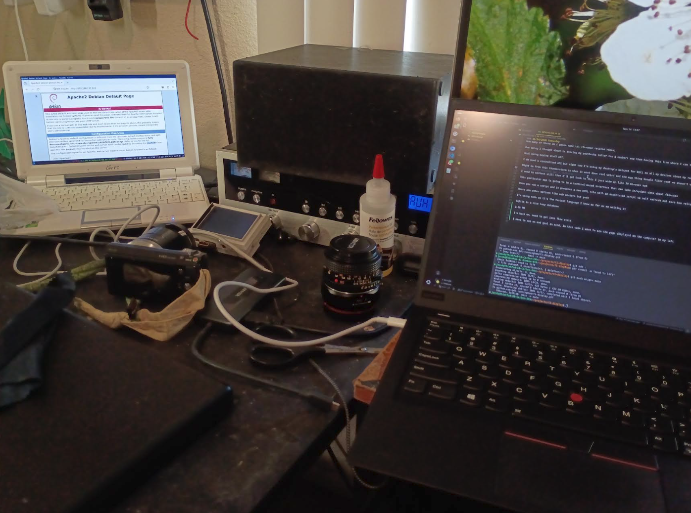

- store data (sqlite)
- script that generates HTML page
- put on Apache RPi server

### 11/14/2026 Saturday

2:05 PM

How many of these am I gonna make lol (finance related repos)

One thing I thought about is storing my paychecks (after tax $ number) and then having this line where I can tell if I followed my goal

Goal being paying stuff off.

I do need a centralized API but right now I'm using my desktop's hotspot for WiFi on all my devices since my router doesn't work/broke

Might be from this thunderstorm is when it went down real weird and the egg thing Google Fiber sent me doesn't work

I need to workout still then I'll get back to this I just woke up like 30 minutes ago

This particular app is going to be a terminal-based interface that can take in/update data about finances

Then you run a script and it produces a new HTML file with an associated script to self refresh not sure how reliable `setTimeout` is

There are other options like web workers but yeah

I'm using node as it's the fastest language I know as far as me writing it

Sqlite is a nice lazy database

2:56 PM

I'm back on, need to get into flow state

I need to see an end goal in mind, in this case I want to see the page displayed on the computer to my left

Damn this is the vibe too Mrs Magic Orchestral version

Alright let's lock in, Kornholio has been engaged we are not chilling we are working

Writing this on my Carbon X1 gen 6, I got an X220 for the keyboard that'll be interesting

3:06 PM

I want to mention the reason I obsess over finances is I'm a dumbass

I have $100K of debt (really around $90K) but I have not addressed it.

I've had my current six-fig job for 2 years now and I have not reduced my debt in fact I have increased it by like 10%

I literally opened up $7K new credit/loan and I burned it all in a couple weeks of going out

And unfortunately alcohol is what has caused me the most problems in my life... although I have not sworn it off completely

I have been sober for 2 weeks now but right now it's how I socialize/meet other people is go to bars

My problem is I don't stop once I start drinking

So when I move to the city I'm hoping I meet more people sober outside of bars

I have not been living life, the last 10 years of my life have been the same where I live in a rural area and I just go to work, gym, groceries that's it

Then I got this feeling of FOMO and I started going out to meet people (women)

I've had wins and losses (more loses than wins) and unfortunately it was from the alochol (nobody likes a belligerent guy)

Anyway yeah... also I don't have savings, no stocks, nothing... I have been living check to check

It's not like I don't have spare money I just burn it at the bars or strip clubs and other things, the highest I've spent is $2K in one night

So yeah I want to get some savings in case I lose my job I can pay my rent then start paying off debt, I actually don't need much to live on

About 50% of my monthly bills is from debt

This is why I want a thing that displays my finance status all the time so I don't forget about it

Fahhh here we go, "I... I am confused..." good song Korn Need To

