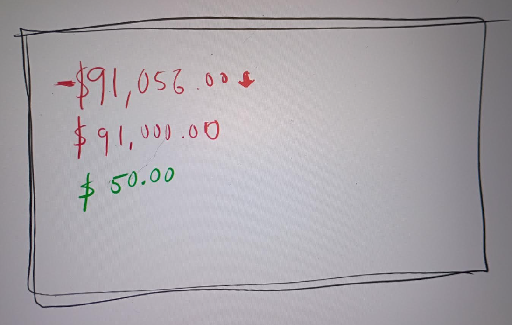
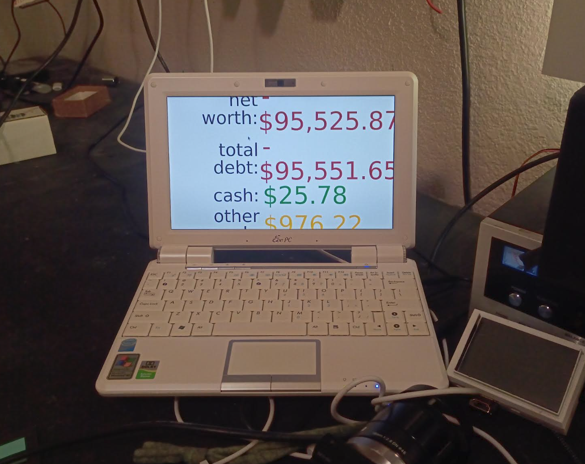
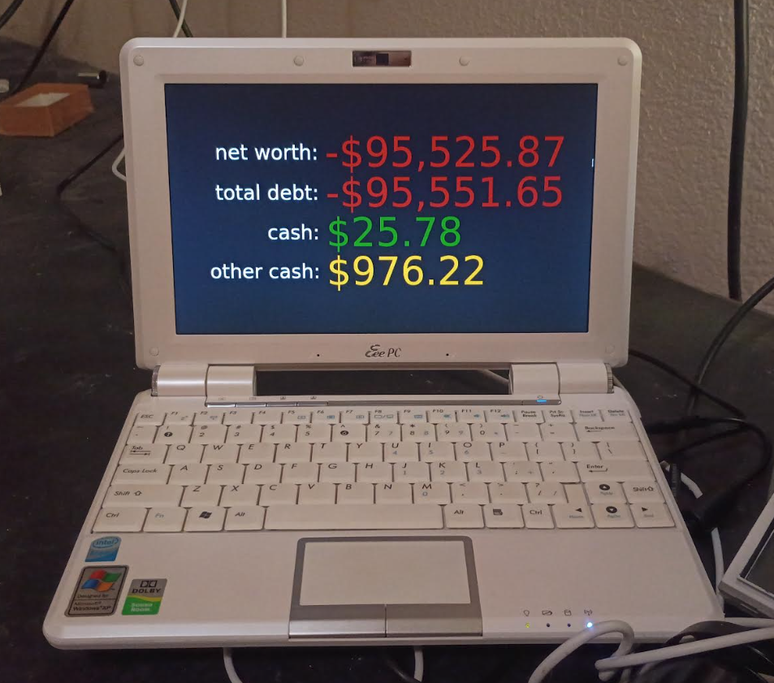

- [ ] CRUD
  - [ ] create (sqlite)
    - [ ] store credit card
    - [ ] store loan
    - [ ] store cash
    - [ ] store asset
    - [ ] add new table for balance updates
- [ ] update
    - [ ] credit card
    - [ ] loan
    - [ ] cash
    - [ ] asset
- [ ] delete
    - [ ] credit card
    - [ ] loan
    - [ ] cash
    - [ ] asset
- [ ] script that generates HTML page
- [ ] put on Apache RPi server

### 11/15/2026 Sunday

2:17 PM

Working out is really important, for me especially

It's a natural "make me feel good" thing

I woke up today kind of in a lull, I felt at ease, calm you know

Which isn't a bad thing but I also had no motivation

I didn't want to work out, but I make myself work out

Right now I'm doing body weight and elastic band:

- 10 squats
- 30 pushups in a specific position (wide, tri, inner)
- front and side laterla raise (band)
- hand stand dips against a wall
- 10 situps

It's not much but I do that 30 times, right now I can't go to a gym so this works

And yeah by the third set I'm feeling it, like sweating, I actually open a window to let more air in

Today I'm going to work on HTML, I am going to have a file eg. `values.js` or something like that

This will get read by the HTML template

I will add a webworker 5 second counter updater thing

This will show my debt growing in real time

I have a very basic design in mind...

The ASUS Eee PC 1000HA display is a 10" display (diagonal) so it's not big

It will have labels like "net worth" but you can see the majority of the screen is taken up

by big numbers

Going to write down the values on a Google Spreadsheet then have them here

2:46 PM

That moment when you realize your bank account balance will be negative come Monday when

all the scheduled payments go through

it's alright I think I fixed it... I set aside $1,575.00 so that's good.

2:54 PM

It's pretty bad I'll have auto payments get charged back and they're not even that much

Like $146 here $114 there

Will add a line in there for money from credit limit, I don't want to consider it part of cash

Just know that I do have that option

Alright I've got the values

3:08 PM

For assets looks like I have just over $1K of resellable lenses and assuming 35% loss

if I really want to sell em it's like $703 and yeah my debt is around $95.6K

3:16 PM

Yeah I am not feeling motivated but I need to lock in and get this display built

I like the web worker stuff it gives the web page life when it self updates.

3:27 PM

Ooh this is a good one Taking What's Not Yours gotta sing that on Karaoke one day

3:28 PM

Quick break need to water my plants

3:50 PM

Alright did that, some chores and got coffee

The web worker part I've made that before

In order to pull it off regarding growth I'll need individual balances and the APRs factored in

3:54 PM

Ahhh overwhelming myself need to work on the display first then dynamic live interest growth after

Ooh another good song Let Go RAC

4:11 PM

Alright I've got something displayable will put it on my Pi 4B 4GB server and show it on the Eee PC that is constantly on.

That keeps going down... I'll put it on the picam for now

That one is the farthest pi away even though it's just a Pi Zero I have higher confidence in it

4:17 PM

Oh shhiiiii another good song The Basement Lunar Vacation

4:25 PM

First attempt is too big, also I may prefer dark background

4:33 PM

Interesting F11 (full screen) makes it too big

4:38 PM

Lol people asking me for money "sure bro I'm only $95,500 in debt" but yeah I can help you

Meanwhile I can be homeless myself since I'm a dumbass and have no savings living check to check

I have given away over $100K to family in my lifetime so far

What I want is that animated up/down ticker

Ahh I gotta do that math part so it has life... I will do the web worker part first

---

### 11/14/2026 Saturday

2:05 PM

How many of these am I gonna make lol (finance related repos)

One thing I thought about is storing my paychecks (after tax $ number) and then having this line where I can tell if I followed my goal

Goal being paying stuff off.

I do need a centralized API but right now I'm using my desktop's hotspot for WiFi on all my devices since my router doesn't work/broke

Might be from this thunderstorm is when it went down real weird and the egg thing Google Fiber sent me doesn't work

I need to workout still then I'll get back to this I just woke up like 30 minutes ago

This particular app is going to be a terminal-based interface that can take in/update data about finances

Then you run a script and it produces a new HTML file with an associated script to self refresh not sure how reliable `setTimeout` is

There are other options like web workers but yeah

I'm using node as it's the fastest language I know as far as me writing it

Sqlite is a nice lazy database

2:56 PM

I'm back on, need to get into flow state

I need to see an end goal in mind, in this case I want to see the page displayed on the computer to my left

Damn this is the vibe too Mrs Magic Orchestral version

Alright let's lock in, Kornholio has been engaged we are not chilling we are working

Writing this on my Carbon X1 gen 6, I got an X220 for the keyboard that'll be interesting

3:06 PM

I want to mention the reason I obsess over finances is I'm a dumbass

I have $100K of debt (really around $90K) but I have not addressed it.

I've had my current six-fig job for 2 years now and I have not reduced my debt in fact I have increased it by like 10%

I literally opened up $7K new credit/loan and I burned it all in a couple weeks of going out

And unfortunately alcohol is what has caused me the most problems in my life... although I have not sworn it off completely

I have been sober for 2 weeks now but right now it's how I socialize/meet other people is go to bars

My problem is I don't stop once I start drinking

So when I move to the city I'm hoping I meet more people sober outside of bars

I have not been living life, the last 10 years of my life have been the same where I live in a rural area and I just go to work, gym, groceries that's it

Then I got this feeling of FOMO and I started going out to meet people (women)

I've had wins and losses (more loses than wins) and unfortunately it was from the alochol (nobody likes a belligerent guy)

Anyway yeah... also I don't have savings, no stocks, nothing... I have been living check to check

It's not like I don't have spare money I just burn it at the bars or strip clubs and other things, the highest I've spent is $2K in one night

So yeah I want to get some savings in case I lose my job I can pay my rent then start paying off debt, I actually don't need much to live on

About 50% of my monthly bills is from debt

This is why I want a thing that displays my finance status all the time so I don't forget about it

Fahhh here we go, "I... I am confused..." good song Korn Need To

Ehh I should use typescript need to get that down, typing is good

3:25 PM

Making some progress my arms hurt from working out lol and I'm just using body weight/a 30 lb exercise band

I think it's the posture more than anything that's getting me (raised right angle to type)

3:38 PM

I forgot to write about this but I don't trust myself with money eg. I'll go ou and burn it all

So my most recent paycheck I had a friend hold onto $1.6K for me so I can make sure I have my

downpayment for my new apt that I'll move into at the start of Dec.

It's bad having only one source of income and no savings, I mean you're f'd if you lose your job

I have stuff to sell but it's not much and I have to worry about packaging it/getting it

to the post office

I'd like to be able to go out and not get f'd up where I lose control

It's hard because I have this mindset/mentality where I have to "reach a state" to have a good time

That state is like 10 long islands (after a big meal) and then I start to have a buzz

That's why my bar tabs sometimes are over $100 for one place and I hop around all over

Usually I'd go out for 6 sometimes more than 1 day partying overnight, there's a place

that opens at 6:30 in the morning and serve alcohol so I'd last till then and continue into

Sunday afternoon it's bad, at that point you're done, mentally done just on

I would start to get heart burn too like it hurts to drink alcohol as my throat burns

I think my main regret from binge drinking is I probably made myself dumb

I was a physics and engineering student, in my calc classes I got A's and B's when I was a frehsman

Granted that math is easy but later on I became a C student and I just started failing classes

I didn't finish college but I was lucky I got into computers as I wasn't exposed to them

Until I was in college so it's not like I wrote code when I was a kid/highschooler

I played with RC planes as a kid

Alright done reminiscining I'm making progress with the initial models/interfaces and setting up

DB calls

4:48 PM

Damn this sqlite viewer extension interface is nice

Little boxes on screen activate monke neurons

Oh man this is a good one, Narcissistic Cannibal

5:09 PM

Damn I haven't listened to this music in a while like New Jacket Literature

Chill vibes

5:19 PM

Man yeah... this was like my favorite song for a while Sunder Hibou makes me think optimistically

I'm living in the city that's what I regret about my life at this point, I've been living secluded

I'm going to fix it soon hopefully

Oh yeah Near Sleeper Plums fahhhhh good shit

I'm in a good mental state right now I'm only thinking about this right now

5:26 PM

Innocent love... yeah this playlist is a banger Newer Chill Music on my Spotify

5:29 PM

I've been struggling with motivation for a while maybe it's from drinking but you know anhedonia

Couldn't even watch TV/anime just hard to get into anything

The nice thing about alcohol I mean it's a good time, a great time

In the 5 months I went out I interacted with hundreds of people, made new short term friends

I lived... I stop thinking/worrying about shit and just be in the moment

When I learned coding in college I didn't care about it at that time, took C++ and Java I got a B+ and C respectively

Later on though I got the drive to try and make money from Google ad revenue, I started making a bunch

of websites like dating sites, that was a huge learning curve, what is DNS, SSL, a VPS, bound parameter

etc... I didn't succeed in getting rich but eventually I got a job in the field

I'm losing momentum here need another win/small goal

5:40 PM

This work is boilerplate the CRUD I get that, use AI to finish it

I derive joy from writing code, being engaged

But there is also that wall you have to overcome you see the work that has to be done

What is the alternative though watching YouTube I guess or anime

I can't go out until sometime in December to make sure I get moved into my new apt and have spare money

for whatever happens, I'm lucky my friend will help me move, I cancelled my car insurance so can't drive

the u-haul van myself

Fahhhhh I am losing momentum here though, thinking about eating

I need to get the credit card insert working at least

A terminal does suck for an interface vs. a form

5:47 PM

What I can do for a win today is to make the HTML dislay part with hardcoded/real current values

5:53 PM

Nooo I opened YouTube side tracked

Okay trying to store a credit card so need step by step prompts to get the values

6:27 PM

I'm gonna chill

Right now I've got a prompt asking for info, need to add validation/retry if invalid then save

I might come back to this later tonight

6:48 PM

I'm chilling now but I was thinking

Ultimately at least right now I have one source of income

And with known bills/subtractions I should have an expected balance end of month

The main goal being ont living check to check so I should start building my "cash/savings"

7:51 PM

When I eat it's over... no more motivation to do stuff

That's why I don't eat for the first 8 hrs of a day and just subsist on caffeine

I had a thought though, there needs to be history so the updated data needs to be new rows

I need to add another table that tracks balances...

7:55 PM

One thing that's annoying is I usually get paid on Fridays and when you do payments

Like a payment to a credit card, the balance update takes a while, so I'll have to do the offset

eg. update values on the 5th and 20th of the month based on a bi-weekly pay schedule
